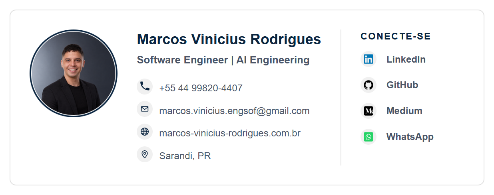

<div align="center">

# 🎨 Assinatura de E-mail

**Assinatura profissional em HTML para e-mail, com design moderno e links funcionais.**

[](https://developer.mozilla.org/pt-BR/docs/Web/HTML) [](https://developer.mozilla.org/pt-BR/docs/Web/CSS) [](https://github.com/MarcosViniciusRodriguesEngSoft)

</div>

---

## 📋 Sobre

Código HTML e assets da minha assinatura de e-mail profissional. Ela foi escrita para funcionar bem em clientes de e-mail, que suportam bem menos HTML/CSS que um navegador:

- ✅ **Layout em tabelas e estilos inline**, o formato mais aceito por Gmail e Outlook
- ✅ **Imagens em PNG**, porque SVG é bloqueado por vários clientes de e-mail
- ✅ **Foto já recortada em círculo** no próprio arquivo, sem depender de `border-radius`
- ✅ **Clicável** — telefone, e-mail, site e redes sociais são links
- ✅ **Botão "Copiar Assinatura"** que copia só a assinatura, pronta para colar

> As imagens são carregadas por URL pública do GitHub (`raw.githubusercontent.com`). Por isso os arquivos de `assets/` precisam estar na branch `main` do repositório.

---

## 🖼️ Prévia

<div align="center">



</div>

---

## 📁 Estrutura

```
signature/
├── assets/
│   ├── preview/
│   │   └── signature.png        # Captura da assinatura (usada no README)
│   ├── profile/
│   │   ├── profile.png          # Foto original
│   │   └── profile-circle.png   # Foto recortada em círculo (usada na assinatura)
│   ├── icons/                   # Ícones de contato (.png usados, .svg são a fonte)
│   │   ├── phone / email / globe / location
│   ├── social/                  # Ícones de redes sociais (.png usados, .svg são a fonte)
│   │   ├── linkedin / github / medium / whatsapp / email
│   └── technology/              # Ícones de tecnologias (não usados na assinatura)
├── signature.html               # Assinatura + botão de copiar
└── README.md                    # Este arquivo
```

---

## 🚀 Como usar

1. **Clone o repositório:**
   ```bash
   git clone https://github.com/MarcosViniciusRodriguesEngSoft/signature.git
   ```

2. **Abra o `signature.html` no navegador** (duplo clique ou *Live Server* no VS Code).

3. **Clique em "Copiar Assinatura".** Se o botão falhar, selecione a assinatura e copie com `Ctrl + C`.

4. **Cole no seu cliente de e-mail:**
   - **Gmail:** Configurações → Ver todas as configurações → Geral → Assinatura → `Ctrl + V` e salvar.
   - **Outlook:** Configurações → Contas → Assinaturas → `Ctrl + V` e salvar.

> ⚠️ **Importante:** cole o **visual renderizado**, nunca o código HTML.

---

## ✏️ Como editar

- **Dados de contato e links:** edite diretamente o `signature.html`.
- **Foto:** troque `assets/profile/profile.png` e gere novamente a versão circular (`profile-circle.png`), quadrada e com fundo branco.
- **Ícones:** mantenha os PNGs com 2x o tamanho exibido (64 px para 20 px) para ficarem nítidos em telas de alta densidade.
- Depois de qualquer mudança em `assets/`, faça o push para a `main`, senão as imagens não aparecem no e-mail.

---

<!--
## 🛠️ Stack

<div align="center">

| Ícone | Tecnologia |
|:---:|:---:|
|  | React |
|  | TypeScript |
|  | Next.js |
|  | Java |
|  | Spring Boot |
|  | NestJS |
|  | PostgreSQL |
|  | MongoDB |

</div>
-->

## 🔗 Links

- 🌐 **Portfólio:** [marcos-vinicius-rodrigues.com.br](https://marcos-vinicius-rodrigues.com.br)
- 💼 **LinkedIn:** [marcosviniciusrodrigues-dev](https://www.linkedin.com/in/marcosviniciusrodrigues-dev)
- 💻 **GitHub:** [MarcosViniciusRodriguesEngSoft](https://github.com/MarcosViniciusRodriguesEngSoft)
- 📝 **Medium:** [@marcos.vinicius.engsof](https://medium.com/@marcos.vinicius.engsof)
- 📱 **WhatsApp:** [+55 44 99820-4407](https://api.whatsapp.com/send/?phone=5544998204407)

---

<div align="center">

**Desenvolvido por [Marcos Vinicius Rodrigues](https://github.com/MarcosViniciusRodriguesEngSoft)**

*Software Engineer | AI Engineering*

⭐ Se este projeto te ajudou de alguma forma, considere dar uma estrela!

</div>